# ambientCG: Rock materials

**26 assets from [ambientCG](https://ambientcg.com), dedicated to the public domain under [CC0](https://docs.ambientcg.com/license/).** Use them in any game, free or paid, and change them however you like; no credit is needed.

PBR materials as 1K and 2K JPG maps (colour, normal GL and DX, roughness, AO, displacement), one folder per resolution. 896.4 MB in all.

This is a copy kept by [zuujis-cc0](https://github.com/zuujis-cc0) so game makers can take single files from GitHub. It is not made by or affiliated with ambientCG: the originals, often in more formats and higher resolutions, are on [ambientcg.com](https://ambientcg.com). If they help you, consider [supporting ambientCG](https://www.patreon.com/ambientCG).

Every file is listed in [MANIFEST.tsv](MANIFEST.tsv) with its size and SHA-256. More free assets: [the Zuujis collection](https://github.com/zuujis-cc0/free-game-assets#readme).

| | | | |
| :-: | :-: | :-: | :-: |
| <a href="Rock001">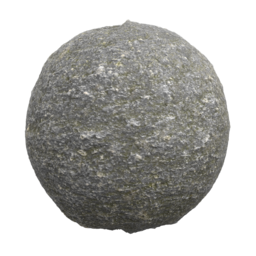</a> <b><a href="Rock001">Rock 001</a></b> by ambientCG · <a href="https://ambientcg.com/a/Rock001">source</a> | <a href="Rock002">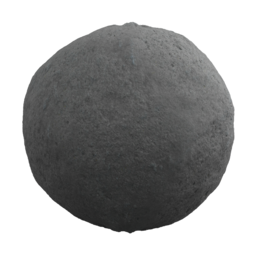</a> <b><a href="Rock002">Rock 002</a></b> by ambientCG · <a href="https://ambientcg.com/a/Rock002">source</a> | <a href="Rock003">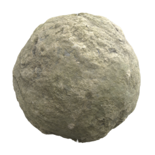</a> <b><a href="Rock003">Rock 003</a></b> by ambientCG · <a href="https://ambientcg.com/a/Rock003">source</a> | <a href="Rock004">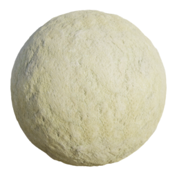</a> <b><a href="Rock004">Rock 004</a></b> by ambientCG · <a href="https://ambientcg.com/a/Rock004">source</a> |
| <a href="Rock005">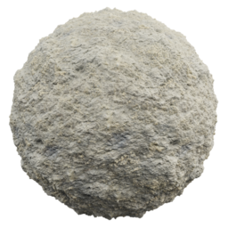</a> <b><a href="Rock005">Rock 005</a></b> by ambientCG · <a href="https://ambientcg.com/a/Rock005">source</a> | <a href="Rock006">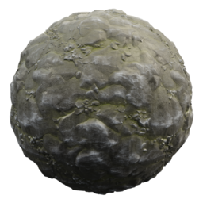</a> <b><a href="Rock006">Rock 006</a></b> by ambientCG · <a href="https://ambientcg.com/a/Rock006">source</a> | <a href="Rock007">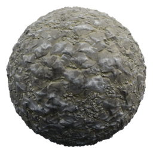</a> <b><a href="Rock007">Rock 007</a></b> by ambientCG · <a href="https://ambientcg.com/a/Rock007">source</a> | <a href="Rock008">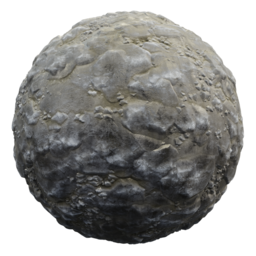</a> <b><a href="Rock008">Rock 008</a></b> by ambientCG · <a href="https://ambientcg.com/a/Rock008">source</a> |
| <a href="Rock009">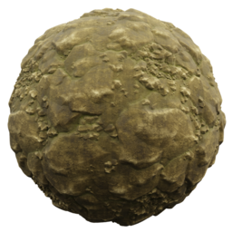</a> <b><a href="Rock009">Rock 009</a></b> by ambientCG · <a href="https://ambientcg.com/a/Rock009">source</a> | <a href="Rock010">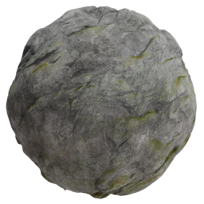</a> <b><a href="Rock010">Rock 010</a></b> by ambientCG · <a href="https://ambientcg.com/a/Rock010">source</a> | <a href="Rock011">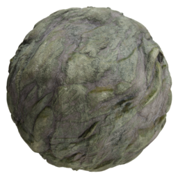</a> <b><a href="Rock011">Rock 011</a></b> by ambientCG · <a href="https://ambientcg.com/a/Rock011">source</a> | <a href="Rock012">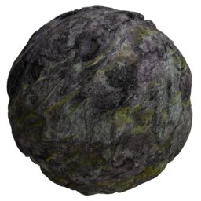</a> <b><a href="Rock012">Rock 012</a></b> by ambientCG · <a href="https://ambientcg.com/a/Rock012">source</a> |
| <a href="Rock013">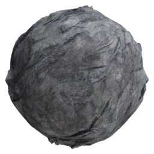</a> <b><a href="Rock013">Rock 013</a></b> by ambientCG · <a href="https://ambientcg.com/a/Rock013">source</a> | <a href="Rock014">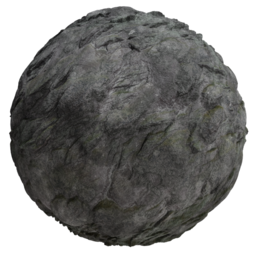</a> <b><a href="Rock014">Rock 014</a></b> by ambientCG · <a href="https://ambientcg.com/a/Rock014">source</a> | <a href="Rock015">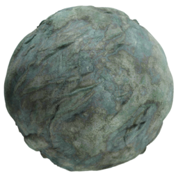</a> <b><a href="Rock015">Rock 015</a></b> by ambientCG · <a href="https://ambientcg.com/a/Rock015">source</a> | <a href="Rock016">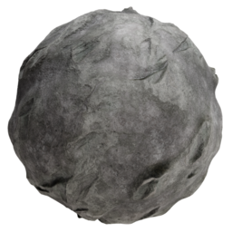</a> <b><a href="Rock016">Rock 016</a></b> by ambientCG · <a href="https://ambientcg.com/a/Rock016">source</a> |
| <a href="Rock017">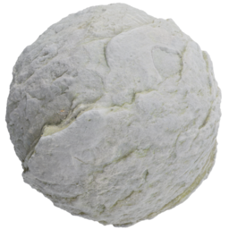</a> <b><a href="Rock017">Rock 017</a></b> by ambientCG · <a href="https://ambientcg.com/a/Rock017">source</a> | <a href="Rock018">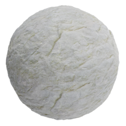</a> <b><a href="Rock018">Rock 018</a></b> by ambientCG · <a href="https://ambientcg.com/a/Rock018">source</a> | <a href="Rock019">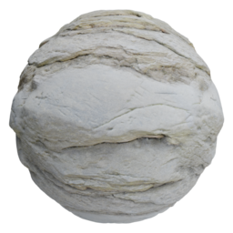</a> <b><a href="Rock019">Rock 019</a></b> by ambientCG · <a href="https://ambientcg.com/a/Rock019">source</a> | <a href="Rock020">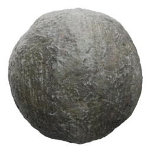</a> <b><a href="Rock020">Rock 020</a></b> by ambientCG · <a href="https://ambientcg.com/a/Rock020">source</a> |
| <a href="Rock021">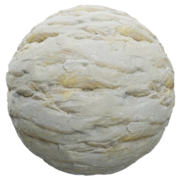</a> <b><a href="Rock021">Rock 021</a></b> by ambientCG · <a href="https://ambientcg.com/a/Rock021">source</a> | <a href="Rock022">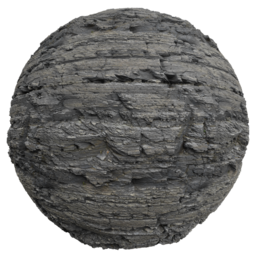</a> <b><a href="Rock022">Rock 022</a></b> by ambientCG · <a href="https://ambientcg.com/a/Rock022">source</a> | <a href="Rock023">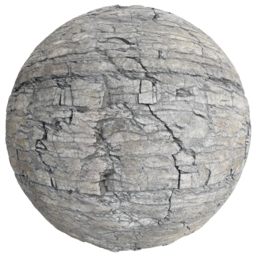</a> <b><a href="Rock023">Rock 023</a></b> by ambientCG · <a href="https://ambientcg.com/a/Rock023">source</a> | <a href="Rock024">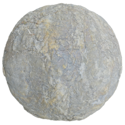</a> <b><a href="Rock024">Rock 024</a></b> by ambientCG · <a href="https://ambientcg.com/a/Rock024">source</a> |
| <a href="Rock025">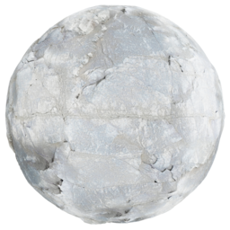</a> <b><a href="Rock025">Rock 025</a></b> by ambientCG · <a href="https://ambientcg.com/a/Rock025">source</a> | <a href="Rock026">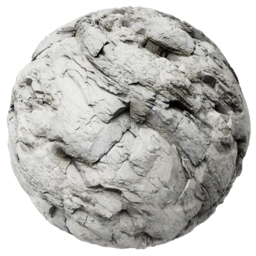</a> <b><a href="Rock026">Rock 026</a></b> by ambientCG · <a href="https://ambientcg.com/a/Rock026">source</a> |  |  |

---

Kept up to date by this repository's own [update workflow](.github/workflows/update.yml), with code and plan from [cc0-mirror](https://github.com/zuujis-cc0/cc0-mirror). Something wrong? [Open an issue there](https://github.com/zuujis-cc0/cc0-mirror/issues/new) or use the [private report form](https://games.zuujis.com/report).
